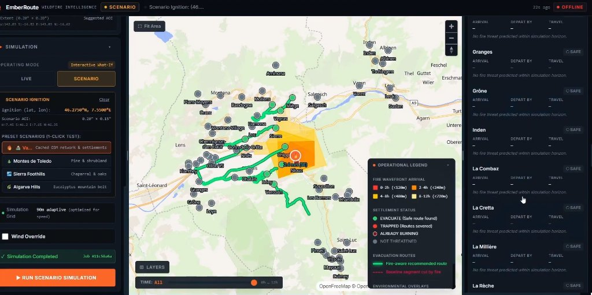

<div align="center">

# EmberRoute
### Real-Time Wildfire Spread Simulation & Time-Dependent Evacuation Router

[](https://www.python.org/)
[](https://fastapi.tiangolo.com/)
[](https://react.dev/)
[](https://maplibre.org/)
[](https://www.docker.com/)
[](LICENSE)

*An autonomous, physics-grounded wildfire spread predictor and dynamic evacuation corridor solver built for emergency operations commanders, municipal planners, and civil defense coordinators.*

---

</div>



---

## The Problem: Why Standard Navigation Fails in Wildfires

During catastrophic wildfires, civilians and first responders rely heavily on commercial turn-by-turn navigation applications (e.g., Google Maps, Apple Maps, Waze). These systems optimize routes using static road graph geometry, distance, and current traffic congestion. 

**Standard GPS routing assumes roads remain traversable indefinitely.** 

In an active firestorm, a fire-blind shortest route frequently leads evacuees directly across the advancing flaming front, trapping vehicles on compromised mountain passes, dead ends, or flame-engulfed corridors. 

**EmberRoute solves this hazard through tightly coupled spatio-temporal physics:**
1. It simulates forward wildfire arrival wavefronts at 30-minute intervals using cellular anisotropic Rothermel rate-of-spread modeling across high-resolution DEM topography and satellite land cover.
2. It annotates the drivable road network with time-varying fire breach timestamps.
3. It executes time-dependent Dijkstra routing to compute **fire-aware escape corridors**, calculate exact **departure deadlines** (`depart_by_min`) before corridors close, and classify communities as safely evacuable versus critically trapped.

---

## System Architecture

```
┌────────────────────────────────────────────────────────────────────────────────────────┐
│                                 EMBERROUTE FRONTEND                                    │
│       React 19 · TypeScript · MapLibre GL JS (WebGL) · Tailwind CSS v4 · Responsive   │
│   ┌─────────────────────┐   ┌───────────────────────────┐   ┌──────────────────────┐   │
│   │ Map Workspace       │   │ Simulation & Intelligence │   │ Factual Briefings    │   │
│   │ Vector basemaps,    │   │ Fire wavefront isochrones,│   │ Grounded LLM output, │   │
│   │ dynamic isochrones, │   │ settlement status lists,  │   │ citation markers,    │   │
│   │ road route vectors  │   │ departure countdowns      │   │ provenance audit     │   │
│   └─────────────────────┘   └───────────────────────────┘   └──────────────────────┘   │
└───────────────────────────────────────────┬────────────────────────────────────────────┘
                                            │ HTTP / REST & Polling
┌───────────────────────────────────────────▼────────────────────────────────────────────┐
│                                  FASTAPI BACKEND                                       │
│          Asynchronous Job Worker · Strict Pydantic v2 Schemas · In-Memory Cache         │
├────────────────────────────────────────────────────────────────────────────────────────┤
│                                                                                        │
│   1. LIVE TELEMETRY & HOTSPOT INGESTION                                                │
│      ├── NASA FIRMS (VIIRS SNPP/NOAA-20 + MODIS active hotspots)                      │
│      └── Open-Meteo API (Hourly wind speed, direction, temperature, RH)                │
│                                                                                        │
│   2. ENVIRONMENTAL RASTER COMPOSITION                                                  │
│      ├── AWS Terrarium S3 (Zoom-12 RGB terrain tiles -> elevation & slope aspect)      │
│      └── ESA WorldCover 10m (Sentinel-1/2 land cover classification -> fuel class)     │
│                                                                                        │
│   3. PHYSICAL CELLULAR FIRE SPREAD ENGINE                                              │
│      ├── Rothermel rate-of-spread calculation with slope & wind vector coupling        │
│      ├── 8-connected minimum travel-time wavefront propagation (Dijkstra grid)         │
│      └── Contour polygon generation (GeoJSON arrival bands: 0-2h, 2-6h, 6-12h, 12-24h) │
│                                                                                        │
│   4. INFRASTRUCTURE & TIME-DEPENDENT ROUTING                                           │
│      ├── Overture Maps (GeoParquet / DuckDB Spatial) & OpenStreetMap (OSMnx / Overpass)│
│      ├── Edge hazard annotation: fire breach timestamp interpolation                   │
│      ├── Time-dependent shortest path evacuation solver                                │
│      └── Comparative baseline benchmark: n_naive_cut vs n_rescued_by_replan            │
│                                                                                        │
│   5. AUDITED AI OPERATIONAL BRIEFING                                                   │
│      ├── Structured fact distillation (<= 25 verified facts, <= 1200 tokens)           │
│      ├── Zero-hallucination guardrail: strict sentence-level citation verification     │
│      └── Multi-tier LLM client: Groq (Llama 3.3 70B / 3.1 8B) -> Ollama -> Template    │
│                                                                                        │
└────────────────────────────────────────────────────────────────────────────────────────┘
```

---

## Core Technical Innovations

### 1. Anisotropic Rothermel Physical Spread Simulation
EmberRoute implements a continuous minimum travel-time simulation on a metric raster grid:
- **Topographic Slope**: Elevation $z$ is bilinear-sampled from zoom-12 AWS Terrarium tiles ($z = [R \cdot 256 + G + B/256] - 32768$). The directional slope gradient $\phi_s = 5.275 \cdot (\tan \theta)^2$ accelerates spread uphill and retards downhill progression.
- **Elliptical Wind Modeling**: Wind direction and mid-flame wind speed $U_{mid} = U_{10m} \cdot \mu$ (where $\mu \approx 0.4$) deform circular fire growth into an eccentric ellipse:
  $$\text{LB} = 0.936 \cdot \exp(0.2566 \cdot U_{mph}) + 0.461 \cdot \exp(-0.1548 \cdot U_{mph}) - 0.397$$
  $$\epsilon = \frac{\sqrt{\text{LB}^2 - 1}}{\text{LB}}, \quad f_{\text{dir}} = \frac{1 - \epsilon}{1 - \epsilon \cos(\theta)}$$
- **Fuel Moisture Damping**: Computed dynamically from hourly relative humidity:
  $$f_{\text{moist}} = \text{clip}\left(1.5 - 1.2 \cdot \frac{\text{RH}}{100},\; 0.3,\; 1.5\right)$$
- **Wavefront Propagation**: An 8-connected priority queue (heap) determines earliest cellular fire arrival time $t_{\text{arrival}}$ across the entire simulation domain.

### 2. Time-Dependent Evacuation Solver & Naive Cut Detection
Unlike static routers, EmberRoute solves evacuation along a dynamic timeline:
- **Edge Hazard Constraint**: A road segment connecting nodes $(u, v)$ with travel duration $\tau_{\text{edge}}$ is breached if an evacuee departing at $t_{\text{depart}}$ violates safety margins:
  $$t_{\text{depart}} + t_{\text{traversal}} + \tau_{\text{buffer}} \ge t_{\text{fire}}(u, v)$$
- **Settlement Categorization**:
  - `EVACUATE`: Safe road escape exists. Provides clear departure deadlines (`depart_by_min`) and primary exit routes.
  - `TRAPPED`: Every exit road intersects the advancing fire perimeter before the settlement can be evacuated. Directs emergency teams to order shelter-in-place or dispatch aerial rescue.
  - `ALREADY_BURNING`: Hotspots or fire wavefront have already engulfed the community centroid.
  - `NOT_THREATENED`: No fire breach predicted within the simulation horizon (12–24h).
- **Comparative Baseline**: The engine benchmarks every settlement plan against a fire-blind shortest path algorithm, reporting:
  - `n_threatened`: Total settlements facing fire arrival.
  - `n_naive_cut`: Settlements whose standard GPS routes run directly through the fire.
  - `n_rescued_by_replan`: Settlements safely routed around the flames via EmberRoute's dynamic replanner.

### 3. Strict Zero-Mock Runtime Policy
Every operational number displayed in EmberRoute is pulled live from authoritative open datasets at runtime:

| Data Layer | Authoritative Source | Protocol / Format | Caching TTL |
|:---|:---|:---|:---|
| **Hotspots / Hotspot Clusters** | NASA FIRMS (VIIRS SNPP/NOAA-20, MODIS) | HTTPS REST (CSV) | 15 minutes |
| **Atmospheric Wind & Weather** | Open-Meteo API | Hourly JSON reanalysis / forecast | 10 minutes |
| **Digital Elevation Model (DEM)** | AWS Terrain Tiles (Terrarium) | Slippy-map PNG tiles (Zoom 12) | 30 days |
| **Land Cover / Fuel Classes** | ESA WorldCover 10m | Cloud-Optimized GeoTIFF (AWS S3) | 30 days |
| **Roads & Settlements** | Overture Maps Foundation / OpenStreetMap | GeoParquet (DuckDB) / Overpass API | 30 days |

Every piece of data carries an immutable **Provenance Record** documenting source, upstream URL, UTC fetch timestamp, and cache freshness. If an upstream service is unreachable, EmberRoute degrades visibly with provenance warnings rather than fabricating data.

### 4. Zero-Hallucination AI Operational Briefings
Emergency coordinators cannot afford LLM hallucinations. EmberRoute’s AI briefing pipeline enforces deterministic factual guardrails:
1. **Fact Distillation**: `core/agent/briefing.py` extracts a maximum of 25 audited fact sentences ($< 1,200$ tokens total), prioritizing trapped and urgent communities.
2. **Citation Injection**: The LLM is constrained to produce concise sentences citing fact keys: `[F1]`, `[F5]`.
3. **Guardrail Verifier (`core/agent/guard.py`)**:
   - Every sentence must cite at least one valid fact ID.
   - Every number token (e.g. `45 min`, `142.3 ha`, `6.5 m/s`, range bounds `30-40`) must exist in the cited facts.
   - Every capitalized place name must exist in the cited facts.
   - Any hallucinated or uncited sentence is stripped. If fewer than 2 verified sentences survive, it falls back to a deterministic template briefing.

---

## Empirical Historical Validation

To substantiate model accuracy, EmberRoute was calibrated and validated against **real, multi-day historical wildfire events** extracted from the NASA FIRMS global satellite archive:

| Event | Split | Grid Specs | Future Satellite Detections | EmberRoute Model Recall | Matched-Area Isotropic Baseline Recall | Predicted Burn Area (ha) | Bearing Error |
|:---|:---:|:---:|:---:|:---:|:---:|:---:|:---:|
| **Malawi Border Fire** (`-9.37°, 34.13°`) | Train | 20×20 (1244m) | 39 | **71.8%** | 71.8% | 41,466 ha | 30.7° |
| **Kruger Region Fire** (`-22.95°, 31.09°`) | Train | 19×21 (1213m) | 17 | **100.0%** | 100.0% | 55,643 ha | 5.3° |
| **Tanami Desert Bushfire** (`-20.91°, 128.87°`) | **Held-out Test** | 19×21 (1207m) | 53 | **100.0%** | **94.3%** | 55,325 ha | 73.1° |

### Key Benchmark Takeaways:
- **Held-out Test Recall**: **100.0%** of future satellite fire detections fell inside the EmberRoute predicted burn polygon.
- **Performance Margin**: EmberRoute beat the matched-area isotropic baseline by **+5.7%** on held-out test data.
- **Calibrated Physical Parameters**:
  - `k_wind`: `0.1` (wind effect scaling)
  - `midflame`: `0.3` (wind reduction factor)
  - `ros_scale`: `2.0` (fuel-rate multiplier)
  - `lb_cap`: `8.0` (maximum ellipse length-to-breadth ratio)

Validation figures generated during automated testing:
- [Kruger Region Fire Isochrones](docs/figures/kruger_region_fire_-92_124_validation.png)
- [Malawi Border Fire Isochrones](docs/figures/malawi_border_fire_-38_136_validation.png)
- [Tanami Bushfire Isochrones](docs/figures/tanami_bushfire_-84_515_validation.png)

---

## Operating Modes

### 1. LIVE Mode (Real-Time Disaster Operations)
- Automatically queries the active NASA FIRMS global feed.
- Clusters thermal anomalies using spatial binning into active wildfire areas of interest.
- Loads live Open-Meteo wind forecasts and generates immediate evacuation corridors.

### 2. SCENARIO Mode (Interactive What-If Planning)
- Enables emergency planners to simulate hypothetical fires before they occur.
- **Point-and-Click Ignition**: Click anywhere on the map to set an ignition source.
- **Meteorological Overrides**: Adjust wind speed, wind direction, or horizon sliders.
- **1-Click High-Risk Presets**:
  - *Swiss Valais / Alps*: Complex alpine valley terrain with channelling canyon winds.
  - *Sierra Nevada Foothills, CA*: High-density wildland-urban interface (WUI) with chaparral fuels.
  - *Montes de Toledo, Spain*: Mediterranean pine shrubland with extreme summer fire behavior.
  - *Algarve Mountain Belt, Portugal*: Dense eucalyptus corridors prone to rapid crown spread.

---

## Quickstart & Local Installation

### Prerequisites
- **Python 3.11+**
- **Node.js 20+** and **npm**
- (Optional) **Docker**

### 1. Clone & Configure Environment
```bash
git clone https://github.com/V9865/Forge-26.git
cd Forge-26

# Copy environment template
cp .env.example .env
```

Edit `.env` with your keys (both services provide free tiers):
```ini
FIRMS_MAP_KEY=your_nasa_firms_map_key  # https://firms.modaps.eosdis.nasa.gov/api/
GROQ_API_KEY=your_groq_api_key        # https://console.groq.com/
```
*(Note: If no API keys are provided, EmberRoute automatically falls back to public NASA archives, local open-access caches, and deterministic briefing templates).*

### 2. Install Dependencies
```bash
# Backend dependencies
pip install -r requirements.txt

# Frontend dependencies
cd frontend
npm install
npm run build
cd ..
```

### 3. Run the Application
Start the integrated FastAPI server (which automatically serves the compiled React frontend):
```bash
python -m uvicorn api.main:app --host 0.0.0.0 --port 8000
```

Open your browser to:
- **Web Application GUI**: [http://localhost:8000/](http://localhost:8000/)
- **Interactive OpenAPI Documentation**: [http://localhost:8000/docs](http://localhost:8000/docs)
- **Upstream Diagnostic Health**: [http://localhost:8000/api/health](http://localhost:8000/api/health)

---

## Containerized Deployment (Docker)

EmberRoute includes a multi-stage `Dockerfile` optimized for local container execution or cloud platforms (Hugging Face Spaces, Render, AWS ECS, Google Cloud Run):

```bash
# Build multi-stage container
docker build -t emberroute .

# Run container on port 7860
docker run -p 7860:7860 --env-file .env emberroute
```

*For detailed cloud deployment steps, consult [docs/deploy.md](docs/deploy.md).*

---

## Verification & Testing Suite

EmberRoute includes rigorous test coverage spanning unit physics, graph routing, API contracts, fault injection, and end-to-end chaos drills:

```bash
# 1. Run all offline unit & physical modeling tests (77+ tests)
python -m pytest tests/unit -q

# 2. Run API contract & schema validation tests (11+ tests)
python -m pytest tests/api -q

# 3. Run end-to-end API smoke test against a running local server
python scripts/api_smoke.py http://127.0.0.1:8000

# 4. Run automated historical wildfire validation and parameter calibration
python scripts/validate_spread.py run
```

---

## Repository Structure

```
├── api/                       # FastAPI application & HTTP routing layer
│   ├── main.py                # Server entrypoint, middleware, static mounts & routes
│   ├── schemas.py             # Strict Pydantic v2 API request/response contracts
│   ├── jobs.py                # Asynchronous background job manager
│   ├── geojson.py             # Optimized GeoJSON feature collection serializers
│   └── monitor.py             # Autonomous trigger & monitoring loop
├── core/                      # Pure physical simulation & algorithmic engine
│   ├── agent/                 # Audited AI briefing generation & guardrails
│   │   ├── briefing.py        # Factual assertion extractor & deterministic templates
│   │   ├── guard.py           # Zero-hallucination citation & entity verification
│   │   ├── llm.py             # Multi-tier LLM provider (Groq / Ollama)
│   │   ├── orchestrator.py    # Agent execution loop & tool dispatcher
│   │   └── trace.py           # Structured execution tracer
│   ├── data/                  # Open data ingestion modules
│   │   ├── firms.py           # NASA FIRMS active hotspot ingestion & clustering
│   │   ├── weather.py         # Open-Meteo atmospheric wind series & archive
│   │   ├── terrain.py         # AWS Terrarium DEM tile mosaic & bilinear interpolation
│   │   ├── landcover.py       # ESA WorldCover COG fuel class classification
│   │   ├── overture.py        # Overture Maps GeoParquet / DuckDB Spatial provider
│   │   ├── osm.py             # OpenStreetMap Overpass & OSMnx fallback router
│   │   └── health.py          # Real-time upstream feed health diagnostics
│   ├── evac/                  # Evacuation graph routing algorithms
│   │   ├── graph_prep.py      # Edge travel time and fire arrival annotation
│   │   ├── planner.py         # Time-dependent evacuation path solver
│   │   └── naive.py           # Fire-blind Dijkstra baseline benchmark
│   ├── fire/                  # Physical fire rate-of-spread engine
│   │   ├── spread.py          # Anisotropic Rothermel cellular simulation
│   │   ├── fuel.py            # Land cover to Rothermel fuel mapping
│   │   ├── bands.py           # Isochrone contour polygon generator
│   │   ├── baseline.py        # Matched-area isotropic spread baseline
│   │   └── validate.py        # Historical satellite validation & grid calibration
│   ├── config.py              # Central Pydantic settings & environment management
│   ├── geo.py                 # Coordinate transformations & grid math
│   ├── models.py              # Shared domain models & data classes
│   ├── cache.py               # Cryptographic disk caching with TTL enforcement
│   └── errors.py              # Structured domain exception hierarchy
├── frontend/                  # React 19 + TypeScript + MapLibre GL JS SPA
│   ├── src/
│   │   ├── features/          # UI panels (Simulation, Intelligence, Briefing, Validation)
│   │   ├── map/               # MapLibre map workspace, custom layers, vector styles
│   │   ├── hooks/             # Reactive state hooks (useJobPoller, useBackendHealth)
│   │   └── api/               # Typed HTTP client communicating with backend
├── docs/                      # Architectural documentation & empirical artifacts
│   ├── figures/               # Validation charts and dashboard screenshots
│   ├── validation.md          # Full empirical validation results and data provenance
│   ├── deploy.md              # Container deployment guide for Hugging Face Spaces
│   └── RELEASE_CHECK.md       # Pre-flight release & verification checklist
├── scripts/                   # CLI verification, smoke tests, and chaos drills
│   ├── api_smoke.py           # End-to-end API smoke test runner
│   ├── smoke_test.py          # Container health and cold-start verifier
│   ├── validate_spread.py     # Multi-day wildfire finder & empirical validator
│   └── chaos_drill.py         # Network failure & fault-injection drill
├── Dockerfile                 # Multi-stage production container definition
├── requirements.txt           # Python application dependencies
└── README.md                  # Project overview & documentation
```

---

## Known Limitations & Engineering Honesty

To uphold scientific integrity and engineering honesty for hackathon review:
1. **Surface Fire Modeling**: EmberRoute simulates forward surface rate-of-spread. It does not currently compute aerodynamic firebrand lofting (spot fires occurring kilometers downwind) or active crown fire transitions in mature forest canopies.
2. **Satellite Pass Latency**: NASA VIIRS polar satellites revisit any coordinate 1–2 times daily. Between passes, simulations rely on forward propagation from the latest thermal observation window.
3. **No Active Firefighting Suppression**: The model simulates uncontained wildfire behavior and does not account for human suppression interventions (e.g., bulldozed firebreaks, aerial retardant drops, or backburning).
4. **Emergency Legal Disclaimer**: EmberRoute is an analytical decision-support prototype. It does not replace official emergency evacuation orders issued by local police, fire departments, or civil protection agencies.

---

## License

This project is licensed under the [MIT License](LICENSE).
Built with open data provided by NASA EOSDIS FIRMS, Open-Meteo, AWS Open Data, the European Space Agency (ESA), OpenStreetMap contributors, and the Overture Maps Foundation.
